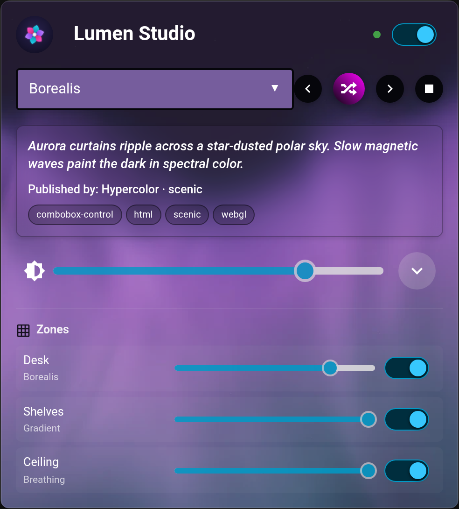
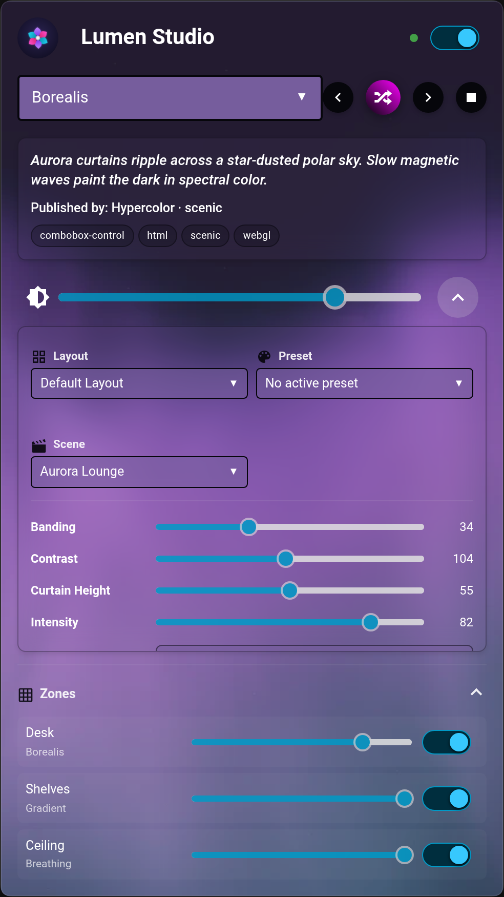
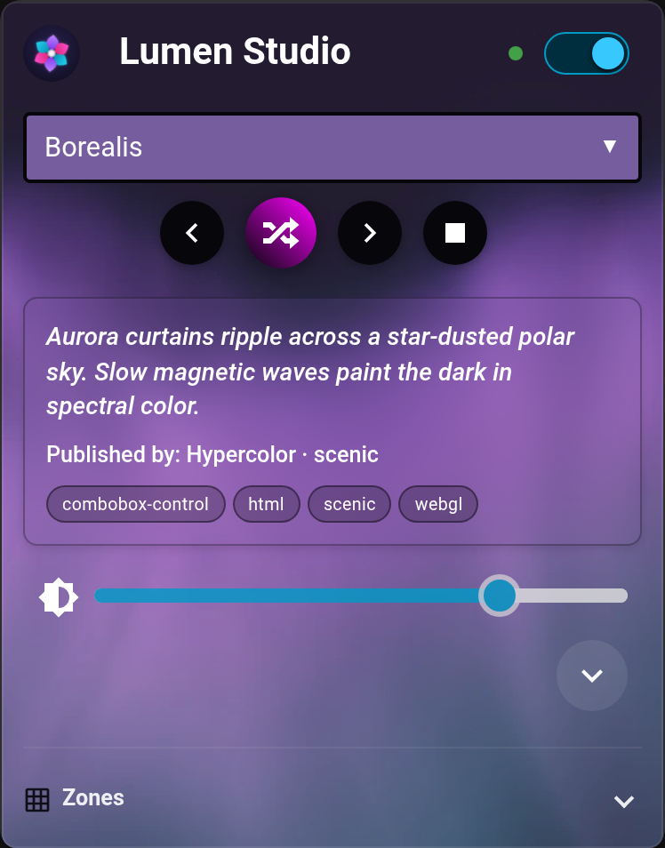

# hyper-light-card

[![HACS Custom][hacs-shield]][hacs]
[![GitHub Release][releases-shield]][releases]
[![License][license-shield]](LICENSE)

Control [Hypercolor](https://github.com/hyperb1iss/hypercolor-hass) and
[SignalRGB](https://github.com/hyperb1iss/signalrgb-homeassistant) lights from a
Home Assistant dashboard. The card discovers companion entities, follows the
running effect's colors, and provides a visual configuration editor.

[Install](#installation) · [Configure](#configuration) · [Configuration reference](docs/configuration.md) · [Develop](CONTRIBUTING.md)

## Screenshots

| Compact | Live controls | Phone width |
| --- | --- | --- |
|  |  |  |

[Watch the demo](https://github.com/hyperb1iss/hyper-light-card/releases/download/v1.2.0/hyper-light-card-demo.mp4)
· [Demo setup](docs/demo.md)

## Installation

Install either the Hypercolor or SignalRGB Home Assistant integration first.
For Hypercolor 0.8, use the integration's 0.7.1 release and its supported Home
Assistant version (2026.9.4 or newer).

### HACS

1. Open HACS, then its top-right menu and **Custom repositories**.
2. Add `https://github.com/hyperb1iss/hyper-light-card` with type **Dashboard**.
3. Find **hyper-light-card** in HACS and download it.
4. Reload your browser, then add **Hyper Light Card** to your dashboard.

See the [HACS custom repository instructions](https://www.hacs.dev/docs/faq/custom_repositories/)
if your HACS interface differs. If you manage dashboard resources in YAML,
register `/hacsfiles/hyper-light-card/hyper-light-card.js` as a module yourself.

### Manual installation

1. Download `hyper-light-card.js` from the [latest release][releases].
2. Copy it to `www/hyper-light-card.js` inside your Home Assistant configuration
   directory. Restart Home Assistant once if you just created the `www` folder.
3. Open **Settings → Dashboards → Resources** and add
   `/local/hyper-light-card.js` with type **JavaScript module**.
4. Reload the browser.

For resources managed in YAML, follow Home Assistant's
[resource configuration guide](https://contributors.home-assistant.io/frontend/custom-ui/resources/).
After an update, refresh the browser cache or change the resource URL's version
query, for example `/local/hyper-light-card.js?v=1.2.0`.

## Configuration

Edit a dashboard, add **Hyper Light Card**, and select the integration's main
light. The editor detects the backend and offers the relevant visibility
options. You can also add a manual card:

```yaml
type: custom:hyper-light-card
entity: light.hypercolor_hyperia
```

For SignalRGB:

```yaml
type: custom:hyper-light-card
entity: light.signalrgb
```

Use your actual entity ID. Hypercolor names its hub after the daemon instance,
so a daemon named `Hyperia` creates `light.hypercolor_hyperia`. Companion controls
are discovered through Home Assistant's device and entity registries, including
renamed entities. Set `backend: hypercolor` or `backend: signalrgb` to override
auto-detection.

The [configuration reference](docs/configuration.md) covers visibility flags,
allowed effects, colors, and explicit companion entity overrides.

## Controls

- **Power and brightness:** toggle the light with the power switch; drag the brightness
  slider to set the level.
- **Effects:** choose an effect, or use previous, next, and random navigation.
  The information panel shows the effect's description, publisher, and tags.
- **Hypercolor:** select scenes, adjust live parameters, control scene zones,
  and toggle audio reactivity. Optional device rows show brightness and provide
  Identify for individual lights.
- **SignalRGB:** select layouts and presets exposed by the integration.
- **Keyboard:** use Tab to reach controls, Enter or Space to open a selector or
  choose an option, and arrow keys or Home/End to navigate. Escape closes the
  selector and returns focus.

Controls appear when the integration provides their entities and options.
Zones start collapsed; select **Zones** to expand their controls.
Hypercolor numeric controls use sliders, boolean controls use switches, and
enum controls use selectors. Color values appear as read-only swatches;
unsupported control types are omitted.
The card uses the running effect's artwork for its accent colors and falls back
to the Home Assistant theme when the image cannot be read.

## Troubleshooting

### The card is missing from the picker

Check that the JavaScript resource URL loads successfully in your browser and
is registered as a module. Reload the page after adding or updating the
resource. Home Assistant safe mode does not load custom dashboard resources.

### Effect colors fall back to my Home Assistant theme

Palette extraction needs browser access to the cover image. For Hypercolor,
add your Home Assistant origin (scheme, host, and port) to the daemon's
`web.cors_origins`, for example `http://homeassistant.local:8123`. The browser
must also be able to reach the daemon's image URL. An HTTPS dashboard cannot
load insecure HTTP artwork without the browser blocking it.

### The Preset selector is missing

Hypercolor lists presets for the running effect. Save a preset for that effect
to populate the selector; an empty list hides it.

### A live control returns to its previous value

Home Assistant reports a service error when the daemon rejects a change. The
card restores the latest confirmed value. Snapshot scenes are locked; choose
an editable live scene for parameter changes. Edits to live scenes persist.

### The wrong backend is selected

An unavailable light may lack the attributes used for detection. Set
`backend: hypercolor` or `backend: signalrgb` explicitly.

### Companion controls are missing

Discovery waits for the device and entity registries. Helpers attached to a
different device cannot be associated automatically. Use the overrides in the
[configuration reference](docs/configuration.md) to pin their entity IDs.
Unavailable live, audio, and zone controls are disabled; scene zones absent
from the current scene are hidden.

## Development

See [Contributing](CONTRIBUTING.md) for local Home Assistant setup, checks, and
release builds. Bug reports should include the card version, Home Assistant
version, backend integration version, and a minimal card configuration.

## License and credits

Licensed under [Apache-2.0](LICENSE). Built with [Lit](https://lit.dev/) and
[ColorThief](https://lokeshdhakar.com/projects/color-thief/) for
[Home Assistant](https://www.home-assistant.io/).

Created by [Stefanie Jane](https://github.com/hyperb1iss).
[Buy me a Monster Ultra Violet](https://ko-fi.com/hyperb1iss).

[hacs-shield]: https://img.shields.io/badge/HACS-Custom-pink.svg?style=for-the-badge
[hacs]: https://www.hacs.dev/
[releases-shield]: https://img.shields.io/github/release/hyperb1iss/hyper-light-card.svg?style=for-the-badge
[releases]: https://github.com/hyperb1iss/hyper-light-card/releases/latest
[license-shield]: https://img.shields.io/github/license/hyperb1iss/hyper-light-card.svg?style=for-the-badge
